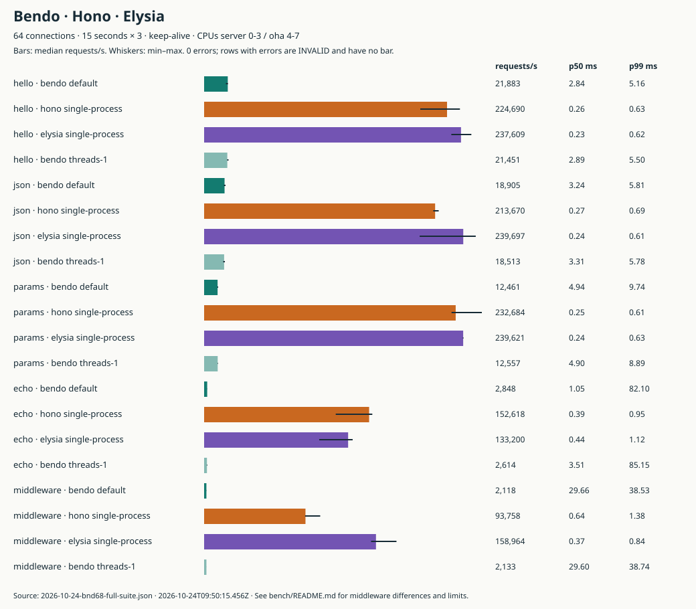

# Bendo

Bendo is a web framework for [Bend](https://bend-lang.com) v2, modeled on
[Hono](https://hono.dev), plus a TypeScript toolkit for calling a Bendo server
from React with full types. You write routes, middleware and handlers in Bend
and compile them to one native binary. The pure parts of the framework
(request parsing, routing, JSON, validation, middleware policies) come with
machine-checked proofs.

Bendo is pre-alpha. Nothing is on npm yet, and the API can still change. The
[plan](docs/PLAN.md) lists what v1 includes and what is left.

## Quick start

These steps were run as written on a fresh Ubuntu 24.04 x64 machine. They
install Bun, Bend and clang, build the hello example, and then create and run a
new API app.

Install the system packages and Bun 1.4.4:

```sh
sudo apt-get update
sudo apt-get install -y ca-certificates curl git unzip clang
curl -fsSL https://bun.sh/install | bash -s bun-v1.4.4
export PATH="$HOME/.bun/bin:$PATH"
```

Bendo pins Bend 2.0.38 in [`.bend-version`](.bend-version). The installer at
bend-lang.com always installs the newest release (2.0.39 as of 2026-10-24), and
it has no version option, so download the pinned release directly. The SHA-256
below is the published 2.0.38 Linux x64 archive:

```sh
curl -fsSL https://github.com/bendlang/bend/releases/download/v2.0.38/bend-2.0.38-linux-x64.tar.gz -o /tmp/bend-2.0.38.tar.gz
echo "f19d088b079c9e1a8834ecd153b7d58c11a5f8f9ab1bdb78dbc96a6bf49aaa81  /tmp/bend-2.0.38.tar.gz" | sha256sum -c -
mkdir -p ~/.bend
tar -xzf /tmp/bend-2.0.38.tar.gz -C ~/.bend --strip-components=1 --warning=no-unknown-keyword
export PATH="$HOME/.bend/bin:$PATH"
export BEND_NO_TELEMETRY=1
bend version
```

The last line prints `bend 2.0.38`. On macOS, or on Linux arm64, take the
matching archive from the
[2.0.38 release](https://github.com/bendlang/bend/releases/tag/v2.0.38) and
drop the `--warning` flag, which only GNU tar knows. Only Linux x64 is tested.
Add `~/.bun/bin` and `~/.bend/bin` to your shell's PATH for later sessions.

Clone the repository and run the hello example:

```sh
git clone https://github.com/opencoredev/bendo.git
cd bendo
bend examples/hello/main.bend -o hello
./hello &
sleep 1
curl http://127.0.0.1:8787/todos/42
kill %1
```

The compile took 32 seconds on a four-CPU machine, and the curl prints
`Hello from Bendo! You asked for /todos/42`. The server listens on
127.0.0.1:8787; set `PORT` to change the port.

Now create an app with `create-bendo`. Until it is published, run it from the
checkout:

```sh
bun install --frozen-lockfile
bun packages/create-bendo/src/index.ts ../my-api --template api
cd ../my-api
bun install
bun run build
./dist/server &
sleep 1
curl http://127.0.0.1:8787/hello/Ada
kill %1
```

The curl prints `{"message":"Hello, Ada!"}`. `bun run build` writes the native
binary to `dist/server`; it took 51 seconds on the same machine. During
development, `bun run dev` rebuilds the server on every `.bend` save. The
`fullstack` template adds a React app; see
[create-bendo](packages/create-bendo/README.md).

## Examples

| Example | What it shows |
| --- | --- |
| [`examples/hello`](examples/hello/main.bend) | The smallest app: one route, one handler. |
| [`examples/store`](examples/store/main.bend) | Shared state in a `B.Store`: a counter and a todo list behind JSON routes. |
| [`examples/mandelbrot`](examples/mandelbrot/README.md) | A handler that renders the Mandelbrot set on one core, every core or the GPU. |
| [`examples/todo`](examples/todo/README.md) | A fullstack todo list. A Bend API with route validation, a store and CORS, and a React app that uses the typed client, the TanStack Query helpers and the same Bend validators in the browser. |
| [`examples/chat`](examples/chat/README.md) | Chat rooms over WebSocket publish and subscribe, with presence, bounded history and a React client that reconnects. |
| [`create-bendo` templates](packages/create-bendo/README.md) | `api` and `fullstack` starter apps. |

Compile a Bend example with `bend examples/<name>/main.bend -o <name>`, as in
the quick start. The todo example runs through Bun; its README has the steps.

## Benchmarks

Bendo is much slower than Hono and Elysia today. On hello world, one Bendo
process serves about 22,000 requests per second, and Hono on Bun serves about
225,000: roughly 10 times more. The gap is wider for the heavier scenarios.



Median requests per second over three 15-second runs, from
[the full suite at `cacf12b`](bench/results/2026-10-24-bnd68-full-suite.json):

| Scenario | Bendo | Hono | Elysia | Hono ÷ Bendo |
| --- | ---: | ---: | ---: | ---: |
| Hello (`GET /`, text) | 21,883 | 224,690 | 237,609 | 10× |
| JSON (`GET /json`) | 18,905 | 213,670 | 239,697 | 11× |
| Params (`GET /user/:id`) | 12,461 | 232,684 | 239,621 | 19× |
| Body echo (1 KiB JSON) | 2,848 | 152,618 | 133,200 | 54× |
| Five middleware | 2,118 | 93,758 | 158,964 | 44× |

All 60 measurements had zero errors. They ran on a Boat large sandbox (AMD
Ryzen 9 9950X, 8 vCPUs, 16 GB). The server was pinned to CPUs 0 to 3 and the
oha 1.16.0 load generator to CPUs 4 to 7, with 64 keep-alive connections, a
discarded 3-second warmup, Bun 1.4.4, Hono 4.13.13, Elysia 1.4.30 and Bend
2.0.38. Each framework ran as one process. This compares frameworks on one
shared VM; it is not a production throughput figure.
[bench/README.md](bench/README.md) has the full method and how to rerun it.

A Bendo process uses about one core whatever its thread count, because the Bend
runtime runs all IO on one event loop. [Workers](docs/workers.md) run several
processes on one port with `SO_REUSEPORT`. In a separate session with the same
setup, four workers served 63,129 hello requests per second against 19,031 for
one, and 5,278 middleware requests against 1,969
([decision 0017](docs/decisions/0017-workers.md)). Workers share no memory, so
each one has its own stores and rate limiters, and the default stays at one.

[Decision 0014](docs/decisions/0014-performance.md) records what made Bendo 4
times faster than its first measurement and where the time still goes. CI
fails a commit whose hello throughput drops more than 25% below a pinned
baseline.

## Proofs

[`LAWS.bend`](LAWS.bend) and the law modules it imports under `proof/` state
more than 650 laws about Bendo's pure code, and
[`PROOF.bend`](PROOF.bend) proves every one. `bun scripts/laws-index.ts` prints
the current count. Bend's proof checker runs on a Lean-backed kernel. The laws cover, among
other things:

- every well-formed request, written out, parses back to the same request, and
  a client always finds a response body where the head says it is;
- the trie router returns exactly what a simple reference router returns, for
  every route table and path;
- every admissible JSON value survives a write and parse round trip;
- CORS, secure headers and CSRF decide what separately written specifications
  say, and a rate limiter allows exactly `limit` requests in a window;
- the faster rewrites on the request path equal the definitions the other laws
  were proven against.

The laws say nothing about IO. The accept loop, sockets and timers live in thin
shells that the integration tests exercise against real compiled servers.
[The laws in plain words](docs/laws/README.md) explains every law and lists
what they do not cover.

To check the proofs yourself, install Lean through elan as described in
[CONTRIBUTING.md](CONTRIBUTING.md), then run:

```sh
bun run prove
```

It prints `ALL PROOFS CHECK` when every proof holds.

## Documentation

- [Develop a Bendo app](docs/cli.md): `bendo new`, `dev`, `build`, `start` and
  `gen`.
- Routing: [patterns](docs/router-patterns.md), [methods](docs/router-methods.md)
  and [composing route lists](docs/router-compose.md).
- [Context](docs/context.md), [middleware](docs/middleware.md) and
  [lifecycle hooks and plugins](docs/guides/plugins.md).
- [Route validation](docs/validation.md), [the typed client](docs/client.md)
  and [TanStack Query helpers](docs/query.md).
- [Shared state](docs/store.md), [static files](docs/static.md),
  [the proxy](docs/proxy.md), [WebSocket](docs/websocket.md) and
  [Server-Sent Events](docs/sse.md).
- [Public entrypoints and the route manifest](docs/manifest.md).

## Contributing

[CONTRIBUTING.md](CONTRIBUTING.md) covers the toolchain, the checks and the
rules for laws and tests. Agents also read [AGENTS.md](AGENTS.md).

## License

MIT. See [LICENSE](LICENSE).
